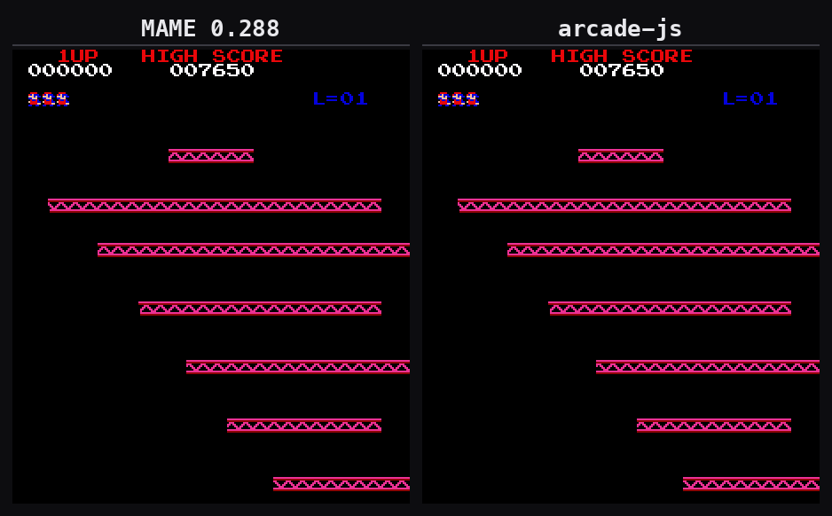

# arcade-js

**An experiment in using AI agents to port existing software.** The disassembly, the
translation, the tests and the tooling in this repo were produced by agents. Arcade ROMs are
the testbed, chosen for one reason: **you can prove whether the port is correct.**

Most porting work has no oracle. You rewrite something, it looks right, and "faithful" stays
a matter of opinion. An arcade ROM doesn't have that problem — MAME already runs it, so there
is a reference implementation emitting exact expected output. Correctness becomes falsifiable
and frame-by-frame: did our JavaScript produce the same pixels as the original machine code, within a measured tolerance,
or did it not?

Concretely, then: arcade games **translated from their original machine code to JavaScript**,
checked **frame by frame against MAME**. Not a re-implementation from observation — the ROM is
disassembled and translated instruction by instruction, then checked frame against frame until
the rendered output matches MAME's within a measured pixel tolerance.

That falsifiable translation is the foundation. What's built on top of it is the part worth looking at.

## The ROM comes back as readable code

A translation that matches MAME is still machine code wearing a JavaScript costume — correct, and nearly
as opaque as the bytes it came from. So every routine is **decompiled again**, into idiomatic
JavaScript with **English names and comments that explain what the code is for**.

Here is one routine from The Pit. This is what the machine contains — disassembled from
`games/thepit/rom/maincpu.bin`, unannotated, because the ROM holds no names, no comments and no
explanation:

```
06AC   ld b,003h
06AE   ld c,007h
06B0   ld a,(0805ch)
06B3   dec a
06B4   ld (0805ch),a
06B7   cp 004h
06B9   jr z,$+10
06BB   and a
06BC   jr nz,$+20
06BE   ld a,008h
06C0   ld (0805ch),a
06C3   ld hl,089fdh
06C6   ld de,091fdh
06C9   ld a,(de)
```

*First 14 of 75 instructions, `0x06AC`–`0x0737`.*

And this is what comes back out — same behaviour, proven memory-equivalent to a faithful
instruction-for-instruction translation of those bytes, and now saying what it is *for*:

<!-- BEGIN GENERATED: listing games/thepit/idiomatic/glitterJewels.js -->
```js
/**
 * glitterJewels — cycle the colour of the on-screen diamond cells so they glitter: each frame
 * advance one diamond cell's colour attribute through the palette; a collected diamond drops out
 * of the set and holds a fixed colour.
 *
 * A free-running countdown at GLITTER_COUNTDOWN runs 8 → 7 → ... → 1 and reloads to 8 when it
 * reaches 0, so it repeats on a fixed eight-frame period. Each value it passes through names one
 * fixed screen cell — a colour byte paired with the video byte holding the glyph shown there. If
 * that glyph is the cell's "animating" glyph, its colour attribute steps to the next of eight
 * shades (the running flash); otherwise the cell is pinned to its resting colour. The value-4 step
 * and the wrap-through-0 land on the same cell, so seven distinct cells share the cycle; any value
 * outside 2..7 falls to the value-1 cell. Called once per main-loop pass as a decorative recolour.
 */

import {
  GLITTER_COUNTDOWN,
  JEWEL_GLITTER_TILE_1,
  JEWEL_GLITTER_TILE_2,
  JEWEL_GLITTER_TILE_4,
  JEWEL_GLITTER_TILE_3,
  JEWEL_GLITTER_TILE_5,
  JEWEL_GLITTER_TILE_6,
  JEWEL_GLITTER_TILE_7,
  JEWEL_GLITTER_COLOUR_5,
  JEWEL_GLITTER_COLOUR_6,
  JEWEL_GLITTER_COLOUR_7,
  JEWEL_GLITTER_COLOUR_1,
  JEWEL_GLITTER_COLOUR_2,
  JEWEL_GLITTER_COLOUR_3,
  JEWEL_GLITTER_COLOUR_4,
} from "./names.js";

// Countdown value → the cell it recolours:
//   [ colour-RAM cell (written), video-RAM cell (read), animating glyph, resting colour ]
const CELLS = {
  7: [JEWEL_GLITTER_COLOUR_7, JEWEL_GLITTER_TILE_7, 0x3a, 7],
  6: [JEWEL_GLITTER_COLOUR_6, JEWEL_GLITTER_TILE_6, 0x3b, 3],
  5: [JEWEL_GLITTER_COLOUR_5, JEWEL_GLITTER_TILE_5, 0x3a, 7],
  4: [JEWEL_GLITTER_COLOUR_4, JEWEL_GLITTER_TILE_4, 0x3c, 3],
  3: [JEWEL_GLITTER_COLOUR_3, JEWEL_GLITTER_TILE_3, 0x3a, 7],
  2: [JEWEL_GLITTER_COLOUR_2, JEWEL_GLITTER_TILE_2, 0x3d, 3],
};
// Countdown value 1, and any stray value outside 2..7.
const CELL_DEFAULT = [JEWEL_GLITTER_COLOUR_1, JEWEL_GLITTER_TILE_1, 0x3a, 7];

function recolorCell(m, colourCell, tileCell, animatingGlyph, restingColor) {
  const { mem8 } = m;
  if (mem8[tileCell] === animatingGlyph) {
    // Glyph animating: advance the colour attribute one shade of eight.
    mem8[colourCell] = (mem8[colourCell] + 1) % 8;
  } else {
    // Glyph idle: hold the cell at its resting colour.
    mem8[colourCell] = restingColor;
  }
}

export function glitterJewels(m) {
  const { mem8 } = m;

  // Step the countdown one and store it back; the value it now holds selects the
  // cell recoloured below. (In play it runs 8..1; the byte store wraps for free.)
  const countdown = mem8[GLITTER_COUNTDOWN] - 1;

  if (countdown === 0) {
    // Wrapped: reload for the next cycle, then recolour the shared value-4 cell.
    mem8[GLITTER_COUNTDOWN] = 8;
    recolorCell(m, ...CELLS[4]);
    return;
  }

  mem8[GLITTER_COUNTDOWN] = countdown;
  recolorCell(m, ...(CELLS[countdown] ?? CELL_DEFAULT));
}
```
<!-- END GENERATED -->

*`games/thepit/idiomatic/glitterJewels.js`, complete, with only the SPDX licence header removed.*

**That name is the point.** Nothing in the ROM says "glitter", and nothing in it names a jewel — the
bytes are a countdown, a table of screen cells and a colour step. That those cells are the jewels on
screen, and that a collected one drops out of the cycle and holds still, is a finding about the
*game*, recovered by watching it run. It lives in the name and the comment because there is nowhere
in the machine code for it to live.

Every such routine keeps a gate proving it memory-equivalent to the faithful translation, so
readability is never bought with correctness. Where each game stands in that sweep is in the
[status table](#games) below.

Alongside the code, the game's **mechanics** are written up in the same way: *grounded by playing it
in MAME*, not guessed from the source. The same oracle does double duty — a **gate** that checks the
pixels against MAME's within a measured tolerance, and a **probe** we drive to learn what the game means. The whole method is one page:
[docs/README.md](docs/README.md).

**Donkey Kong** is the first subject, and its port is complete — matched to MAME within the pixel gate's tolerance, and fully playable.
**The Pit** (Zilec/Centuri, 1982) is
the second, and it was chosen deliberately: **no public disassembly of it exists**, so there was
nothing for a model to have memorized — the agents had to recover it from the raw ROM. That makes
it the sharper test of the thesis, and the same falsifiable pixel gate keeps it honest. The repo
is structured to host many: multiple CPUs, multiple arcade boards, and multiple game romsets,
sharing what they genuinely share.

How the agents were organised — the division of labour, the failure modes we actually hit, and
what the tooling had to do about them — is written up in
[docs/how-the-agents-worked.md](docs/how-the-agents-worked.md).

> **Status — Donkey Kong:** plays. All four boards, natural board-to-board progression, and the
> level loop all work — finish 100m and it wraps back to 25m at the next level, indefinitely —
> and the rendering is checked frame by frame against MAME 0.288, within a measured pixel tolerance.

## Games

Generated from `games/registry.js`, each game's `manifest.js` and its `DONE.md` by
`node tools/gen_readme.mjs --write`; `npm test` fails when it is stale.

<!-- BEGIN GENERATED: game status -->
| Game | Board (MAME machine config) | CPU | Runtime | Idiomatic layer complete (`idiomaticComplete`) | Done audit |
|---|---|---|---|---|---|
| [Donkey Kong](games/dkong/) | `dkong` | z80 | idiomatic | not declared | [DONE.md](games/dkong/DONE.md) |
| [The Pit](games/thepit/) | `thepit` | z80 | idiomatic | not declared | [DONE.md](games/thepit/DONE.md) |
| [Frogger](games/frogger/) | `frogger` | z80 | idiomatic | yes | [DONE.md](games/frogger/DONE.md) |
| [Time Pilot](games/timeplt/) | `timeplt` | z80 | idiomatic | yes | [DONE.md](games/timeplt/DONE.md) |
| [Pooyan](games/pooyan/) | `pooyan` | z80 | idiomatic | yes | [DONE.md](games/pooyan/DONE.md) |
| [Space Invaders](games/invaders/) | `invaders` | 8080 | idiomatic | yes | [DONE.md](games/invaders/DONE.md) |
| [Galaxian](games/galaxian/) | `galaxian` | z80 | idiomatic | yes | [DONE.md](games/galaxian/DONE.md) |
| [Centipede](games/centiped/) | `centiped` | 6502 | idiomatic | yes | [DONE.md](games/centiped/DONE.md) |
| [Tempest](games/tempest/) | `tempest` | 6502 | idiomatic | yes | [DONE.md](games/tempest/DONE.md) |
<!-- END GENERATED -->

### How close to MAME

Each game's done-audit records how its shipped (idiomatic) layer compares with MAME. No game is
pixel-identical on every frame checked; some segments are. As recorded in each `DONE.md`:

- **Donkey Kong:** nearest-frame worst 1.45% of pixels in attract, 0.89% in gameplay.
- **The Pit:** nearest-frame worst 0.67% in attract, 0.56% in gameplay.
- **Frogger:** nearest-frame worst 0.22% in attract, 3.35% in gameplay.
- **Time Pilot:** RAM byte-exact against MAME on every compared frame of 10-minute attract and
  gameplay runs; pixels worst 449 px (attract) and 2261 px (gameplay), with a pinned cap on how many
  frames may exceed the per-frame band.
- **Pooyan:** title and story frames byte-identical (3506 of 4900 attract frames); the attract demo
  drifts by at most 21 px; gameplay nearest-frame worst 5.13%.
- **Space Invaders:** 10 s of attract byte-exact (0.00%); gameplay nearest-frame worst 0.22%; the attract demo
  drifts up to about 13.6% (a documented residual).
- **Galaxian:** nearest-frame worst 0.45% in attract, 0.78% in gameplay; a 120 s attract run nearest-frame worst 1.34%.
- **Centipede:** 600 s attract nearest-frame pixel difference average 0.000%, worst 0.078% (bounded to
  frame 33000); gameplay is not compared with MAME directly (the trackball input model differs) — the shipped
  layer is checked against the oracle layer by machine state, and the oracle against MAME.
- **Tempest:** byte-exact on 59.8% of attract frames and 19.7% of gameplay frames; 99.3% and 98.6%
  within a 1% band.

## What's here (and what isn't)

This repo ships our **tools**, our **translation** (the JavaScript — our own expression of the
ROM's logic), and our **understanding** — each game's `gameplay.md` (how it's played, from public
research) and `mechanisms.md` (the code-grounded model of how it works). It does **not** ship the
copyrighted ROM data, nor the gitignored **build metadata** — `dk.asm`, `coverage.json`,
`blocks.def`, `unreached.txt` under `games/dkong/out/` (regenerate locally with `make trace`). You
supply your own ROM; `make rom-dkong` assembles and **sha256-verifies** it locally. See
[`games/dkong/rom/README.md`](games/dkong/rom/README.md).

### You still need the ROM — here's why

The translation replaces the ROM's **logic**, not its **contents**. A ROM is not only code:

- **Graphics and palette are pure data.** `gfx1` (8×8 tiles), `gfx2` (16×16 sprites) and the
  colour `proms` have no code in them at all. Without them there is nothing to draw.
- **The code reads the ROM as data.** Donkey Kong's first game-state handler runs
  `ld hl,0x01ba` / `ldir`, copying a table straight out of ROM. So the engine still maps the
  ROM into the address space and reads from it — our JavaScript is what *executes*, the ROM
  is still what it *reads*.

Which is exactly why the copyright line falls where it does: the JavaScript is our own
expression of the logic and it ships; the original data is Nintendo's and it never does.

## How we know it's right

If the question is whether agents can port software faithfully, the answer is only worth as
much as what could have proven it wrong. These gates are the experiment's instrumentation,
and every one of them runs from a clean checkout:



*Donkey Kong's game-start intro: MAME on the left, arcade-js on the right, driven by the same
input tape and aligned with the pixel gate's own frame offset. Both panels are rendered from
the very `frames.rgb` artifacts the gate diffs — not a screen recording of two windows. Shown
at 2× speed; over this 35-second run the largest single-frame difference is 0.17%.*

- **Pixel gate.** Capture a golden from **live MAME 0.288** under a pinned, determinism-
  controlled command line, run the same input tape through our engine, and diff the frames.
  Movement 6/6 and bonus-item 9/9 scenarios pass across all four board types. Those scenarios
  poke the board state to start on a given board, which keeps each one short and deterministic
  — that's a property of the fixtures, not a limit of the game, which progresses on its own.
- **Decoder cross-check.** Our Z80 decoder is checked against `z80dasm` over the code the
  tracer decodes in Donkey Kong's ROM: 6411 instruction boundaries,
  zero disagreements in either direction (`make verify`).
- **Step audit.** Every `m.step()` target in the translation is verified to land on a real
  instruction boundary (`make stepcheck`). The static tracer reaches ~82% of the ROM, and a
  target it never decoded is reported as **unresolved rather than excused** — either the step is
  wrong, or the tracer is missing an entry point and the map is simply incomplete. Both are work;
  neither is a pass. Treating them as gaps hid 836 bytes of live code for two weeks.
- **Several thousand unit tests** (`npm test`), with mutation patches recorded next to the
  assertions they justify, so a test that cannot fail is visible as such. Each idiomatic rewrite
  additionally carries a memory-equivalence test against the frozen oracle, with deliberately-broken
  twins it must catch.
- **State and write diffs.** RAM and the hardware write surface are diffed independently of
  pixels, which separates "the CPU translation is wrong" from "the video model is wrong."

## Layout

```
core/                 game-agnostic engine
  cpu/z80.js          the Z80 processor        (any Z80 game reuses this)
  cpu/8080.js         the Intel 8080 processor
  cpu/6502.js         the MOS 6502 processor
  cpu/test/           unit tests for the CPU core
  audio.js            sample-player abstraction (audio lives ABOVE emulation)
boards/               arcade hardware, named by MAME driver (a "board")
  dkong/              memory map · i8257/watchdog/latches · video/palette/geometry
  dkong/hardware.json the same, as JSON: the single source the shared Python gate
                      tools read via --hardware, instead of hardcoding DK addresses
  dkong/test/         unit tests for the board
games/                one directory per romset, listed in games/registry.js (status: see Games above)
  dkong/              for example:
    manifest.js       declares its cpu + board + rom set + inputs + metadata
    translated/       the assembly-JS translation of the ROM (the frozen oracle)
    idiomatic/        readable-JS rewrites, each gated memory-equivalent to the oracle
    audio/            sound-command → sample trigger map
    rom/              gitignored — `make rom-dkong` builds it locally
    tapes/            test input tapes (published)
    test/             unit + integration tests for the translation
    entrypoints.json  disassembly entry points (folded into the trace)
    tools/            per-game gate runners (emit.js · move_suite.py · prize_suite.py)
web/                  browser front-end: pick a game and play it
tools/                disassembler · tracer · MAME golden capture · pixel/state diff ·
                       gate runner (verdict.sh) — shared, game-agnostic
docs/                 the method: one model (docs/README.md) + a technique guide per move
```

Tests are colocated with the code they test (`core/**/test/`, `boards/**/test/`,
`games/**/test/` — see `npm test`'s glob), not in a separate top-level `test/`.

The three layers — **CPU**, **board**, **game** — are independent axes. A game's
`manifest.js` names its CPU and board: Donkey Kong and Frogger, for example, both name `z80` and
share `core/cpu/z80.js`, but each names its own board (`dkong`, `frogger`). The game's `machine.js`
wires that board's memory map and I/O to the ROM images and to the routine layer the manifest's
`runtime` selects: `"idiomatic"` (the Runtime column above) dispatches every routine listed in
`idiomatic/names.js` to its readable rewrite, while the faithful `translated/` layer stays as the
frozen oracle each rewrite is gated memory-equivalent against — and is what runs, on the
cycle-driven engine, when `runtime` is absent.
A board is named for the **MAME machine config** it implements —
usually identical to the driver file (`dkong`), but not always: The Pit runs the `thepit` config
*inside* MAME's `taito/roundup.cpp` family file, so it lives at `boards/thepit/` while its hardware
is cited from `roundup.cpp`. The manifest also declares an `inputs` block (ports, actions,
key bindings) that `web/` reads to build its keyboard map — see [porting](docs/porting.md) — so a manifest
without it can't be played in the browser.

## Quickstart

Bring your own `dkong.zip` and you'll be playing in about a minute:

```sh
make rom-dkong     # assemble your ROM locally (sha256-checked)
make serve         # dev server (sets COOP/COEP), then open the printed URL
```

Pick Donkey Kong, press **5** to drop a coin and **1** to start — arrows or WASD to move,
space to jump.

```sh
npm test           # the full unit suite (ROM-dependent ones skip cleanly if you haven't built one)
```

(`make rom-dkong` is an alias for `make -C games/dkong rom`; `make serve` is an alias for
`npm run serve` — either form works, pick one.)

Requirements: Node, Python 3 (+ numpy, Pillow for the pixel gate), z80dasm (cross-checks the
decoder for `make verify`), and — for regenerating MAME goldens — MAME 0.288 and ffmpeg.

## Adding a game

See **[docs/README.md](docs/README.md)** — the whole method — and [`docs/`](docs/) for the
technique guides. In short: pick (or write) the CPU and board, translate the ROM into
`games/<name>/`, prove it against MAME with the pixel gate, then decompile it to idiomatic JS and *ground*
its mechanics by playing it under MAME.

## License

[GPLv3](LICENSE). The translation and tools are ours and free software; the original ROM
data is not included and is not ours.
