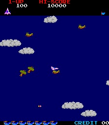

# RAM Usage

Work RAM lives at `0xA800`–`0xAFFF`. Each name below describes the cell by its role in
the running game; the hex address is the stable identity. Cells that share a byte, or
whose role is only partly pinned, carry a terse caveat.

>>> memory

| Address | Name | Description |
| --- | --- | --- |
| a800 | playerState | State byte of the player's own record, which begins at this address. |
| a801 | playerRecordSpareByte | work-RAM byte after PLAYER_STATE (0xA800): zeroed at every life start by resetPlayfieldAndArmNewRound (`ld (0xa801),a` at 0x1A1F) and by the block wipes, and read by no code -- the only reads of it are the wipes' own LDIR source fetches |
| a802 | playerHeading | The heading the player's ship is flying, a full byte = 256 steps of the circle. |
| a808 | worldScrollY | World scroll, the component that lands in a sprite entry's NATIVE-Y byte. |
| a80a | worldScrollX | World scroll, the component that lands in a sprite entry's NATIVE-X byte. |
| a810 | actorRecordSlot0 | Actor slot 0's record head -- first of the four actor/target object slots (array slots 1-4). |
| a811 | waveKillCountdown | How many more qualifying kills until the current wave's shared claim fires. |
| a812 | waveClaimTimer | Frame-countdown window during which a spawned wave's shared claim is armed. |
| a814 | bankLaunchCooldownPeriod | Reload period (interval constant) that re-arms BANK_LAUNCH_COOLDOWN after a launch; never decremented. |
| a817 | bankLaunchCooldown | Live per-vblank cooldown for the bank-launch arm (launchBankEnemyWhenAimedNearPlayer) and the Mother-Ship's homing spawn. |
| a820 | actorRecordSlot1 | Actor slot 1's record head. |
| a821 | claimToken | The shared "last of the wave" token, holding one claimant at a time. |
| a827 | bankLaunchNearHalfWidth | Near-band proximity half-width gating a bank launch, the same value on both axes. |
| a830 | actorRecordSlot2 | Actor slot 2's record head; also the free-slot-search band base. |
| a837 | bankLaunchHeadingHalfWidth | Half-width of the heading window for a bank launch: launchBankEnemyWhenAimedNearPlayer fires only when the craft's heading lies within this of PLAYER_HEADING. |
| a840 | actorRecordSlot3 | Actor slot 3's record head; also doubles as the aimed-spawn era "bank A" record seat. |
| a844 | bankLaunchSlotCount | Count of records the bank-launch arm scans for a free slot (loop bound; zero disables the arm). |
| a850 | craftRecordSlot0 | Slot 0's record, and the iteration base of the whole 7-slot craft band. |
| a860 | craftRecordSlot1 | Slot 1's record head; its per-slot handler seats it and dispatches by era. |
| a870 | craftRecordSlot2 | Slot 2's record head. |
| a880 | craftRecordSlot3 | Slot 3's record head. |
| a890 | craftRecordSlot4 | Slot 4's record head, and the seat of the "cleared" free-slot spawn search. |
| a8a0 | motherShipState | State byte of the Mother-Ship's record, which begins at this address and runs two slots. |
| a8a4 | motherShipHitsToAbsorb | Mother-Ship record +4: the hits it can still absorb. |
| a8b0 | craftRecordSlot6 | Slot 6's record head (the last ordinary craft slot), with two extra duties. |
| a8b4 | motherShipAimSideToggle | The Mother-Ship's homing-launch aim-side toggle: incremented each launch, bit 0 picks the +0x18 / -0x18 side of the aim. |
| a8c0 | eraObjectRecordSlot0 | Era-object bank slot 0's record head -- base of the three-slot per-era special-object bank (array 12-14). |
| a8c6 | attackerSpawnSlotCount | Per-era-and-rung count of enemy slots the attacker / craft-bank spawner fields, 0 to 3: byte +6 of the era/rung settings row ERA_RUNG_SETTINGS_POINTER_TABLE (0x1B04) selects, rising with the rung. |
| a8d0 | eraObjectRecordSlot1 | Era-object bank slot 1's record head (second of the grouped three). |
| a8d4 | attackerSpawnAimSideToggle | The attacker (era-bank) aimed-spawn aim-side toggle: incremented each spawn, bit 0 picks a +0x18 or -0x18 offset off the aim heading. |
| a8d6 | attackerSpawnWindowHalf | Half-width of the proximity window deciding WHETHER the era attacker bank spawns (doubled into a window). |
| a8dc | hitsRemaining | How many more hits the big two-slot object can absorb before it dies. |
| a8e0 | eraObjectRecordSlot2 | Era-object bank slot 2's record head; also doubles as the aimed-spawn era "bank B" record seat. |
| a8e6 | attackerSpawnAimWindowHalf | Half-width of the final launch-facing window for the attacker spawn. |
| a8f0 | parachutistRecord | The parachutist's record head (array slot 15); its +7 is PARACHUTIST_RUNG 0xa8f7. |
| a8f4 | attackerSpawnCooldown | Live shared per-vblank cooldown for the era attacker-bank spawn arms. |
| a8f6 | attackerSpawnCooldownPeriod | Reload period (interval constant) for ATTACKER_SPAWN_COOLDOWN; never decremented. |
| a8f7 | parachutistRung | How many rescue awards this life has already been paid, which is the rung the next one takes. |
| a900 | sceneryRecordSlot0 | Scenery record base, scenery slot 0 (array slot 16); the record cursor runSceneryForEra starts from (paired with SCENERY_ENTRY_SLOT0). |
| a97f | playerStateBlockEnd | inclusive top of the player/actor-state RAM block cleared from PLAYER_STATE when armRoundStartThenStepSequence sets up an attract-demo round (PLAY_ACTIVE clear) |
| a980 | frameTick | Frame counter, advanced once per vblank service. |
| a981 | coinAccepted | Coin-counter pulses the machine still OWES the mechanical counter. |
| a982 | coinAcceptedSlot2 | slot-2 twin of COIN_ACCEPTED (0xa981) |
| a983 | serviceCreditDebounce | IN0 bit-2 service-credit input debounce; a clean edge awards one credit |
| a984 | coinPulseTimer | Frames left in coin slot 1's current mechanical-counter pulse, counted down one frame at a time. |
| a985 | coinPulseTimerSlot2 | slot-2 twin of COIN_PULSE_TIMER (0xa984) |
| a986 | creditCount | packed-BCD on-screen credit total (saturates at 0x99) |
| a987 | screenUnflipped | Whether the picture is the right way up for whoever is playing: 1 upright, 0 turned round. |
| a988 | blankLinesLeft | Lines of the character plane still to blank in the wipe now running. |
| a989 | blankLineCursor | Where the next line of that wipe starts — a 16-bit cell address in the character plane. |
| a98d | highScoreHi | MSB of the single displayed high score (0xA98B/8C/8D): seeded 01 from ROM 0x08C9 at boot (pc 0x52AD), promoted by the lddr at 0x0CD5 when a score beats it |
| a98e | fireButtonEdgeShift | Fire-button edge-detect shift register. |
| a990 | initialsLockedLetterColour | colour a committed initial is painted in: the first entry cell's colour-plane byte, captured when the entry opens and written onto each letter's colour cell as it locks, replacing the cursor's flash colour |
| a991 | scratchPtrA | General 16-bit scratch pointer (first of the pair, 0xA991-A992); dereferenced as a live working cursor, role varies by caller. |
| a993 | scratchPtrB | General 16-bit scratch pointer (second of the pair, 0xA993-A994); sometimes used alone (e.g. as a video-write destination). |
| a995 | initialsBackPressHistory | press history of the facing panel's LEFT control, shifted in every even frame of initials entry: a fresh press steps the letter back round its 27-letter ring, at 0x7F (held) it is emptied through rearmHeldControlRepeat so a held LEFT auto-repeats; zeroed when the entry opens |
| a996 | initialsForwardPressHistory | press history of the facing panel's RIGHT control during initials entry: a fresh press steps the letter forward (26 wraps to 0), at 0xFF it is emptied through rearmHeldControlRepeat so a held RIGHT auto-repeats; zeroed when the entry opens |
| a997 | initialsCommitPressHistory | press history of the facing panel's FIRE button during initials entry: a fresh press locks the shown letter into the next slot; never re-armed, so a held FIRE commits once; zeroed when the entry opens |
| a998 | initialsAltCommitPressHistory | press history of the panel's bit-0x20 control (not bound in this cabinet's input map) during initials entry: a fresh press locks the letter exactly like FIRE and is tested first; zeroed when the entry opens |
| a999 | initialsLetterIndex | index (0..26) of the letter shown at the initials cursor, selecting its glyph from INITIALS_LETTER_GLYPH_TABLE: zeroed when the entry opens, stepped by forward/back, reset to 0 after each committed letter except the last |
| a99a | initialsSlotsLeft | count of initials still to enter: set to 3 when the entry opens, decremented on each committed letter; reaching 0 finishes the entry |
| a99c | initialsCursorFlashTimer | initials cursor blink counter: incremented every odd frame of the entry, bit 4 picks the cursor cell's colour (0x14 over 0x10); zeroed whenever the cursor letter is redrawn |
| a99d | chainWindow | How much longer a hit still counts as part of the current chain. |
| a99e | chainStep | Which rung of the chained-hit award ladder the next hit will be paid at. |
| a9ab | sequencePhase | OUTER phase of the two-level sequence machine: the machine's top-level MODE. |
| a9ac | sequenceSubstep | INNER index of the two-level sequence machine. |
| a9ad | dip1Mirror | inverted mirror of DSW 0xC200 (the gameplay dip bank) |
| a9ae | in0Mirror | Complemented mirror of the IN0 input port, rewritten every frame from the port itself. |
| a9af | in1Mirror | inverted mirror of IN1 0xC320 (main / player-1 controls) |
| a9b0 | in2Mirror | inverted mirror of IN2 0xC340 (cocktail / player-2 controls) |
| a9b1 | coinageSettings | The two coinage DIP settings, as the machine sees them: the complement of the DSW0 port. |
| a9b2 | commandWriteCursor | write index into the 64-cell COMMAND_RING, stepped two cells per posted pair (reader: COMMAND_READ_CURSOR) |
| a9b3 | commandReadCursor | The command ring's CONSUMER cursor: which cell the foreground loop reads next. |
| a9c0 | freePlay | Set while the cabinet is on free play, so a coin never has to buy a credit. |
| a9c1 | startingLives | lives per game (3/4/5/0xff), loaded into PLAYER_ONE/TWO_LIVES at start |
| a9c2 | uprightCabinet | cabinet type from DSW1 'Cabinet' (bit 2), seeded at 0x2E22: 1 = upright, 0 = cocktail; the frame service turns the screen round for player two only when it reads 0 |
| a9c3 | bonusLifeSetting | selects the bonus-life mark list + the attract bonus captions |
| a9c4 | difficultySetting | Which of the eight Difficulty DIP positions the cabinet is set to, 0-7. |
| a9c6 | demoSoundsEnable | attract-sound gate: a queued request is dropped unless set or a game is active |
| a9c7 | coinSlot1Debounce | slot-1 coin-line debounce shift register |
| a9c8 | coinSlot1Accumulator | slot-1 coins-inserted accumulator (+0x10/coin vs COIN_SLOT_1_RATIO 0xa9c9) |
| a9c9 | coinSlot1Ratio | What coin slot 1 charges: coins-required-minus-one in the high nibble, credits in the low. |
| a9ca | coinSlot2Debounce | slot-2 coin-line debounce shift register |
| a9cb | coinSlot2Accumulator | slot-2 accumulator (+0x10/coin vs COIN_SLOT_2_RATIO 0xa9cc) |
| a9cc | coinSlot2Ratio | The same for coin slot 2, from the OTHER nibble. |
| a9cd | killQuota | The kill quota a round is armed with: how many enemies the next round will ask for. |
| a9ce | bcdFrameCounter | free-running packed-decimal frame counter (inc+daa each vblank) |
| a9cf | scriptCycleCounter | 0..4 round-robin index for in-turn script selection (pickScriptAtRandomOrInTurn) |
| a9d0 | attractStageCounter | attract-demo counter cycling 1->2->3->1; each demo starts in that era (PLAYER_ONE_ERA_INDEX) and round (+1) |
| a9d3 | startRungRounds15 | The escalation rung a round STARTS on, for rounds one to five. |
| a9d4 | startRungRounds610 | The same, for rounds six to ten. |
| a9d5 | startRungRounds11Up | The same, for round eleven and up. |
| a9d6 | eraRungPeriod | How many wraps of the base-sixty counter one rung of ERA_RUNG lasts. |
| a9d7 | eraRungTimer | Wraps of the base-sixty counter still to go before ERA_RUNG climbs again. |
| a9e2 | penRouteLeg | Leg index into the pen's fixed rectangular route table; incremented each run to select the next leg. |
| a9e3 | penRowPos | The pen's row position as 8.8 fixed point (a 16-bit word at 0xA9E3; its whole-cell high byte is PEN_ROW_CELL at 0xA9E4). |
| a9e4 | penRowCell | The pen's whole-cell row -- the high byte of PEN_ROW_POS -- which plotPenCell masks to five bits and multiplies by the 32-cell row stride to address the plane; that x32 stride is what makes it the ROW, not the column. |
| a9e5 | penColumnPos | The pen's column position as 8.8 fixed point (a 16-bit word at 0xA9E5; whole-cell high byte PEN_COLUMN_CELL at 0xA9E6). |
| a9e6 | penColumnCell | The pen's whole-cell column -- the high byte of PEN_COLUMN_POS -- added within the row by plotPenCell. |
| a9e7 | penRowStep | Signed 8.8 per-step row increment ((target - PEN_ROW_POS)/16, sign kept), added to PEN_ROW_POS each step. |
| a9e9 | penColumnStep | Signed 8.8 per-step column increment, added to PEN_COLUMN_POS each step. |
| a9eb | sequenceDelay | The sequence machine's shared one-shot delay: frames still to wait before its next step. |
| a9f0 | introAnimationStep | Step selector (0..5) of the between-eras band animation that plays after a round is won and before the next round: stepRoundStartIntroAnimation dispatches on it, and each sub-animation writes the step it hands off to (flash->1, band-to-2->2, colour-cycle->3, band-to-4->4, flood->5). |
| a9f1 | playerFlashTick | Tick of the player-ship white flash (intro step 0/1): bit 0 alternates the sprite colour; at tick 8 it advances INTRO_ANIMATION_STEP and requests the spawn-flash sound. |
| a9f2 | bandTo2PassCountdown | Per-pass countdown for advanceScriptedCharPlaneBandTo2 (bit 0 selects a blank vs draw pass), decremented each pass and zeroed at the script's end, which sets INTRO_ANIMATION_STEP to 2. |
| a9f3 | spriteColourCycleCountdown | Countdown driving a sprite's colour field during the colour-cycle step: seeded 4 and stepped down once per call, so bit 2 is set only on the first call (colour 0x37) and clear for the rest (0x3F); when it reads zero the step sets INTRO_ANIMATION_STEP to 3, and the counter then wraps below zero. |
| a9f4 | bandTo4PassCountdown | Per-pass countdown for advanceScriptedCharPlaneBandTo4 (bit 0 selects blank vs draw), zeroed at the script's end, which sets INTRO_ANIMATION_STEP to 4. |
| a9f6 | colourFloodCountdown | Countdown stepped down once as floodColourPlaneWithSavedPlayerColour finishes painting the colour plane (intro step 4); nothing but that stepper reads it. |
| a9f7 | bandScriptCursor | 16-bit cursor walking the char-plane band script (a byte per plane cell); shared by the band-to-2 / band-to-4 drawers and stepThirteenScriptedGlyphCells, left where it ended. |
| aa10 | playerEntry | The player's sprite entry (array slot 0's X-seat), and the iteration base of the whole entry band. |
| aa11 | playerSpriteCode | The player's sprite code/shape byte = PLAYER_ENTRY +1; dressPlayerSpriteForHeading writes it from a heading-indexed table. |
| aa12 | actorEntrySlot0 | Actor slot 0's sprite entry (paired with ACTOR_RECORD_SLOT0). |
| aa14 | actorEntrySlot1 | Actor slot 1's sprite entry. |
| aa16 | actorEntrySlot2 | Actor slot 2's sprite entry; free-slot-search entry seat. |
| aa18 | actorEntrySlot3 | Actor slot 3's sprite entry; also the aimed-spawn "bank A" entry seat. |
| aa1a | craftEntrySlot0 | Slot 0's sprite entry, and the iteration base of the whole craft entry band; paired with CRAFT_RECORD_SLOT0 in every whole-band walk (entry stride +0x02). |
| aa1c | craftEntrySlot1 | Slot 1's sprite entry (paired with CRAFT_RECORD_SLOT1). |
| aa1e | craftEntrySlot2 | Slot 2's sprite entry. |
| aa20 | craftEntrySlot3 | Slot 3's sprite entry. |
| aa22 | craftEntrySlot4 | Slot 4's sprite entry, and the "cleared" spawn-search entry-cursor seat (parallel to CRAFT_RECORD_SLOT4). |
| aa24 | motherShipEntry | The Mother-Ship's sprite entry (array slot 10), paired with MOTHER_SHIP_STATE 0xa8a0. |
| aa26 | craftEntrySlot6 | Slot 6's sprite entry: the "owed" spawn-search entry-cursor seat, and the Mother-Ship's second sprite entry when armed (parallel to CRAFT_RECORD_SLOT6). |
| aa28 | eraObjectEntrySlot0 | Era-object bank slot 0's sprite entry (paired with ERA_OBJECT_RECORD_SLOT0). |
| aa2a | eraObjectEntrySlot1 | Era-object bank slot 1's sprite entry. |
| aa2c | eraObjectEntrySlot2 | Era-object bank slot 2's sprite entry; also the aimed-spawn "bank B" entry seat. |
| aa2e | parachutistEntry | The parachutist's sprite entry (array slot 15), paired with PARACHUTIST_RECORD. |
| aa30 | sceneryEntrySlot0 | Scenery sprite-entry X seat, scenery slot 0 (array slot 16); base of publishSpriteShadow's 6-byte bank-0 head run (slots 16-18). |
| aa31 | scenerySpriteCodeSlot0 | Scenery sprite code/shape byte, scenery slot 0 (= SCENERY_ENTRY_SLOT0 +1); base of the era-keyed 8-slot code fill (stride 2). |
| aa36 | sceneryEntrySlot3 | Scenery sprite-entry X seat, scenery slot 3 (array slot 19); base of publishSpriteShadow's 10-byte bank-0 tail run (slots 19-23). |
| aa3f | tamperFoldFlag | work-RAM flag set 0xff before the image-signature fold, no routine reads it back by address (foldImageBlockIntoSignatureThenAdvanceSequence) |
| aa40 | playerSpriteAttribute | The player's sprite attribute byte (colour + flip bits), and the base of the second bank's 32-byte attribute/Y run publishSpriteShadow copies to hardware. |
| aa41 | playerSpriteY | The player's sprite Y (vertical) byte, and the base of the Y band hideAllSprites zeroes (hideCaptionSprites zeroes only its first four entries) to park every sprite off-screen. |
| aa43 | actorSpriteYSlot0 | Actor slot 0's sprite Y (array slot 1; = ACTOR_ENTRY_SLOT0 +0x31, one step of the PLAYER_SPRITE_Y band). |
| aa55 | motherShipSpriteY | The Mother-Ship's sprite Y (array slot 10; = MOTHER_SHIP_ENTRY +0x31); read as a scalar in the contact/collision windows. |
| aa59 | eraObjectSpriteYSlot0 | Era-object bank slot 0's sprite Y (array slot 12; = ERA_OBJECT_ENTRY_SLOT0 +0x31); read as a scalar in fixed-target collision. |
| aa60 | scenerySpriteAttributeSlot0 | Scenery attribute (colour+flip) band base, scenery slot 0 (= SCENERY_ENTRY_SLOT0 +0x30); base of publishSpriteShadow's 6-byte bank-1 head run. |
| aa66 | scenerySpriteAttributeSlot3 | Scenery attribute band, scenery slot 3 (array slot 19); base of publishSpriteShadow's 10-byte bank-1 tail run. |
| aa6f | tamperImageSignature | The folded byte-signature of a program-image block (the self-check's checksum); written by the image-fold step and read by address only at ROM 0x2730 as cp 0x76, which jumps to 0x2530 (off the genuine path) on mismatch -- an anti-tamper cell. |
| aa80 | playerShotArray | Base of the player's six-slot shot record array. |
| aa81 | shotBurstPending | Countdown of shots still owed from the current fire press. |
| aa82 | shotSpawnCooldown | Inter-shot fire-rate cooldown: shot-engine passes left before the next player shot may seed. |
| aadf | playerShotArrayEnd | inclusive top of the player-shot RAM block cleared from PLAYER_SHOT_ARRAY when armRoundStartThenStepSequence sets up an attract-demo round (PLAY_ACTIVE clear) |
| ab08 | highScoreTableBase | base of the five 8-byte high-score records (+0 rank, +1..+3 score lo/mid/hi, +4..+6 initials, +7 0xF1 pad) |
| ab0b | highScoreRec0ScoreHi | record 0 score high byte (rank +0, score lo/mid/hi +1..+3): the insertion compare's starting point |
| ab10 | highScoreRec1Base | record 1 base (rank byte) |
| ab18 | highScoreRec2Base | record 2 base (rank byte) |
| ab20 | highScoreRec3Base | record 3 base (rank byte) |
| ab27 | highScoreSlideSrc | top source byte (record 3's +7 pad byte) of the lddr that slides the records below an inserted score down one record |
| ab28 | highScoreRec4Base | record 4 base (rank byte) |
| ab2f | highScoreTableEnd | inclusive top of the high-score table (record 4's +7 0xF1 pad byte, after its three initials); the slide lddr's destination start |
| ab30 | randomRegister | Base of the seventeen-byte shift register the pseudo-random generator advances. |
| ab43 | tamperGlyphCopy | A copy of one character cell's glyph, taken so the anti-tamper machinery can check later that the display still says what it should. |
| abfe | tamperGlyphStrip | Anti-tamper caption witness -- the glyph sampled from copyright-caption cell 0xA61C each await-start frame; the animation strip checks it (cp 0xa5) on its opening frame and diverts to the trap at 0x1f2e on mismatch. |
| abff | tamperColourStrip | The colour byte of the TAMPER_GLYPH_STRIP sample (the sampled cell's colour); checked cp 0x05 / cp 0x10. |
| ac00 | commandRing | The 64-cell command ring: command byte and argument byte in adjacent cells. |
| ac43 | soundQueueCount | Count of queued sound-code bytes in the low-level sound FIFO; the enqueuer increments it, the drain decrements it (0 = empty). |
| ac44 | soundQueueHead | Head (oldest byte) and base of the sound-code FIFO body; the drain sends it, then slides the remaining bytes down. |
| ac64 | enemyAimAnchorY | Y byte of the enemy aim ANCHOR point, whose X is ENEMY_AIM_POINT_TABLE (0xAC65). |
| ac65 | enemyAimPointTable | Base of the enemy aim-point table, and byte-wise entry 0's X = the ship anchor point (0xAC64 = Y). |
| ac74 | enemyStandoffAimSetY | Y byte of the SET standoff aim point (its X is ENEMY_STANDOFF_AIM_SET, 0xAC75). |
| ac75 | enemyStandoffAimSet | X byte of one of the two selectable ship-standoff aim points (pair 0xAC74 = Y). |
| ac79 | enemyStandoffAimClear | X byte of the sibling standoff aim point (pair 0xAC78 = Y), chosen when that selector bit is CLEAR. |
| ac7f | enemyStandoffAimMain | X byte of the most-referenced ship-standoff aim point (pair 0xAC7E = Y). |
| ac83 | enemyStandoffAimBlockEnd | Last byte (base + 0x0F) of that sixteen-byte aim-coordinate block: the inclusive end of armRoundStartThenStepSequence's 0x80 clear loop. |
| acbe | lineWipeSampleRecord | 2-byte work-RAM record the sampled cell's glyph+colour is copied into (parkSpritesAndArmLineWipeThenAdvanceSequence); also written by the attract high-score patch list and copyThreeTilemapCellsFromBothPlanes; no role read by any routine |
| acc0 | eraRung | The escalation rung inside the current era: the low nibble of the (era << 4) + rung index. |
| acc1 | roundCraftCount | Per-round enemy-craft quota: how many craft a round should field. |
| acc2 | waveSpawnBusyFlag | work-RAM busy flag =0xff around the inline wave-build loop, =0 after; no routine reads it back by address, so it locks nothing (driveEnemyWaveForLifePhase) |
| acc3 | waveDescriptorIndex | Descriptor-table selector for the current inline wave: (2 * era) + a random parity bit. |
| acc4 | scriptPickThreshold | Per-round threshold that decides how each spawning craft's movement script is chosen. |
| acc5 | spawnClearedSpareByte | work-RAM byte zeroed when an enemy is spawned into a free slot (spawnEnemyIntoFreeSlotElseStepSearch, `ld (0xacc5),a` at 0x3816) and by the boot wipe, and read by no code |
| acc6 | roundTransitionHold | Nonzero while a round / Mother-Ship transition is underway. |
| acc7 | tamperGlyphKonami | Anti-tamper caption witness -- the glyph sampled from the "(c) KONAMI 1982" caption cell 0xA63C ('N'); checked by the scenery/era arm as cp 0x3b, derailing into the trap at 0x315b on mismatch. |
| ad00 | livesRemaining | Lives the ACTIVE player has left, in the live context block. |
| ad01 | roundNumber | Which round is being played, counting on without wrapping. |
| ad02 | killsRemaining | Enemies still to destroy before the Mother-Ship appears -- the manual's 56. |
| ad03 | bonusLifeLatch | Active context +3: the once-per-mark bonus-life award latch (bit 0); mirrors the saved PLAYER_ONE/TWO_BONUS_LIFE_LATCH. |
| ad04 | eraIndex | Which era (the manual's ROUND) is being played, 0-4. |
| ad05 | lifeTicksLow | Low place of a three-place base-sixty counter, stepped once per dispatch of the round engine's per-frame service block. |
| ad06 | lifeTicksMid | Middle place of that counter, stepped once per wrap of LIFE_TICKS_LOW. |
| ad07 | lifeTicksHigh | High place of that counter, stepped once per wrap of LIFE_TICKS_MID. |
| ad0a | startRung | Active context +0xA: the difficulty rung the round opens on (copied into ERA_RUNG 0xacc0 at reset); mirrors PLAYER_ONE/TWO_START_RUNG. |
| ad0b | penGlyph | The active caption/pen glyph (active context +0x0B, companion of PEN_COLOUR at +0x0C). |
| ad0c | penColour | The live caption/pen colour attribute (active context +0x0C; the saved per-player copies are at 0xAD1C/0xAD2C). |
| ad0d | motherShipArmed | Raised while this round's Mother-Ship has been armed. |
| ad0e | roundArmed | Active context +0xE: the round-armed gate -- set when a round starts (0xFF from startNextRound; the game's first round loads the saved copy's 1), cleared when the round-intro fly-in timer expires; mirrors PLAYER_ONE/TWO_ROUND_ARMED. |
| ad10 | playerOneLives | Player one's lives, in their saved sixteen-byte context block at 0xAD10. |
| ad11 | playerOneRoundNumber | Player one's copy of ROUND_NUMBER (0xAD01), the unwrapped round ordinal. |
| ad12 | playerOneKillsRemaining | Player one's copy of KILLS_REMAINING (0xAD02): craft still to destroy this round, seeded from KILL_QUOTA (0xA9CD). |
| ad13 | playerOneBonusLifeLatch | Player one's copy of the bonus-life award one-shot latch (active 0xAD03, bit 0, set by awardBonusLifeAtScoreMark when the score's top byte reaches a mark, and cleared by it once that byte is off every mark). |
| ad14 | playerOneEraIndex | Player one's copy of ERA_INDEX (0xAD04): which era/round is in force -- the key setSavedPenFromEra and seatCaptionPenFromEraFoldingTamperIntoPhase use for the caption pen. |
| ad16 | playerOneLifeTicksMid | Player one's copy of LIFE_TICKS_MID (0xAD06). |
| ad1a | playerOneStartRung | Player one's copy of the round start rung (active 0xAD0A) -- the difficulty rung the round opens on, later copied into ERA_RUNG. |
| ad1b | playerOnePenGlyph | Player one's saved copy of PEN_GLYPH (saved context +0x0B). |
| ad1c | playerOnePenColour | Player one's saved copy of PEN_COLOUR (saved context +0x0C); the source floodColourPlaneWithSavedPlayerColour reads when ACTIVE_PLAYER selects player one. |
| ad1d | playerOneMotherShipArmed | Player one's copy of MOTHER_SHIP_ARMED (0xAD0D). |
| ad1e | playerOneRoundArmed | Player one's copy of the round-armed gate (active 0xAD0E, which startNextRound sets to 0xFF and the ROM tests as a boolean `and a; ret z`). |
| ad20 | playerTwoLives | Player two's lives, in their saved context block at 0xAD20 -- the same byte, the other block. |
| ad21 | playerTwoRoundNumber | Player two's copy of ROUND_NUMBER -- the same field as PLAYER_ONE_ROUND_NUMBER, the other block. |
| ad22 | playerTwoKillsRemaining | Player two's copy of KILLS_REMAINING; the twin of PLAYER_ONE_KILLS_REMAINING, seeded from KILL_QUOTA. |
| ad23 | playerTwoBonusLifeLatch | Player two's copy of the bonus-life award latch; the twin of PLAYER_ONE_BONUS_LIFE_LATCH. |
| ad24 | playerTwoEraIndex | Player two's copy of ERA_INDEX; the twin of PLAYER_ONE_ERA_INDEX (the caption-pen era key). |
| ad26 | playerTwoLifeTicksMid | Player two's copy of LIFE_TICKS_MID; the twin of PLAYER_ONE_LIFE_TICKS_MID (the round arm's 16-bit store clears the mid/high pair 0xAD26/0xAD27). |
| ad2a | playerTwoStartRung | Player two's copy of the round start rung; the twin of PLAYER_ONE_START_RUNG. |
| ad2b | playerTwoPenGlyph | Player two's saved copy of PEN_GLYPH (saved context +0x0B); the twin of PLAYER_ONE_PEN_GLYPH. |
| ad2c | playerTwoPenColour | Player two's saved copy of PEN_COLOUR; the twin of PLAYER_ONE_PEN_COLOUR. |
| ad2d | playerTwoMotherShipArmed | Player two's copy of MOTHER_SHIP_ARMED; the twin of PLAYER_ONE_MOTHER_SHIP_ARMED. |
| ad2e | playerTwoRoundArmed | Player two's copy of the round-armed gate; the twin of PLAYER_ONE_ROUND_ARMED. |
| ad30 | playActive | Flag set while play is active. |
| ad31 | twoPlayerGame | Two-player-game flag: 0xFF for a two-player game, 0x00 for one player / attract. |
| ad32 | activePlayer | Which of the two players is up: 0 for player one, 1 for player two. |
| ad33 | player1ScoreLo | player 1 score, low packed-BCD byte (tens/units; stays 00, every award is a multiple of 100); awards add here first |
| ad34 | player1ScoreMid | player 1 score, middle packed-BCD byte (thousands/hundreds) |
| ad35 | player1ScoreHi | player 1 score, high packed-BCD byte (hundred-thousands/ten-thousands); the display, bonus-life and high-score compares start here |
| ad36 | player2ScoreLo | player 2 score, low packed-BCD byte (tens/units; stays 00, every award is a multiple of 100); awards add here first |
| ad37 | player2ScoreMid | player 2 score, middle packed-BCD byte (thousands/hundreds) |
| ad38 | player2ScoreHi | player 2 score, high packed-BCD byte (hundred-thousands/ten-thousands); the display, bonus-life and high-score compares start here |
| ad39 | tamperWitness | A two-cell anti-tamper witness, glyph then colour, that one part of the machine seeds and another verifies. |
| adf2 | demoScriptDwell | Attract-demo autopilot: the packed dwell/steer byte -- low 6 bits are the frame countdown, top 2 bits the steering command; reloaded from the next script byte when the dwell expires. |
| adf3 | demoScriptPointerLo | Attract-demo autopilot: low byte of the little-endian cursor into the ROM heading-command script. |
| adf4 | demoScriptPointerHi | Attract-demo autopilot: high byte of the DEMO_SCRIPT_POINTER_LO cursor. |
| adfb | tamperGlyphReadback | Tile-image tamper tripwire: the glyph read back from video cell 0xA5DC; the demo start derails into a data-run trap unless it reads 0xFD. |
| adfc | tamperColourReadback | Tile-image tamper tripwire: the colour read back from cell 0xA1DC; the demo proceeds only if it is 0x10 or 0x05. |
| ae00 | deferredWriteCursor | Write pointer of the deferred character-write list, which runs from 0xAE04. |
| ae04 | deferredWriteList | Head of the deferred-PAINT list -- 4-byte records {addr lo, addr hi, tile, colour} that DEFERRED_WRITE_CURSOR 0xae00 fills and paintDeferredCells drains into both planes; a cursor still == this head means the list is empty. |
| ae80 | deferredBlankCursor | Write pointer of the SECOND deferred cell list, the one holding what to blank. |
| ae84 | deferredBlankList | Head of the deferred-BLANK list (same 4-byte record layout). |
